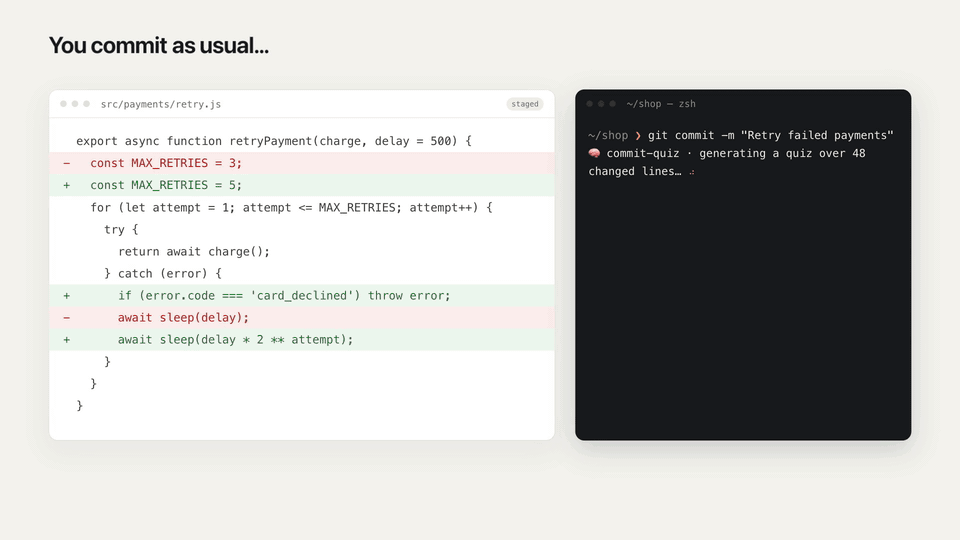

# commit-quiz

A `pre-commit` hook that verifies the developer **actually read their changes**
before committing. Useful when AI agents (Claude Code, Cursor, Codex…) generate
the code and the dev just hits "commit" without reviewing.

Every AI code-review tool reviews the code. This one quizzes **you**.



```bash
npm install -g commit-quiz
commit-quiz install          # in the repo you want guarded
```

## How it works

1. On commit, the hook takes the staged diff (`git diff --cached`).
2. It sends it to an AI CLI you already have and generates **4 statements about
   the diff: 2 true and 2 plausible-but-false** (wrong file, inverted
   condition, different value…).
3. The dev marks which ones are true:
   - **In a terminal**: interactive prompt, with colors.
   - **From the editor UI** (VS Code, Cursor — no terminal): native dialogs
     (macOS via `osascript`, Linux via `zenity` when installed), including a
     "generating…" heads-up and a verdict dialog with the real summary when
     the answer is wrong.
4. On a correct answer the commit goes through. On a wrong one the commit is
   aborted and the **real summary** of the diff is shown.

The hook is **fail-open**: if the LLM does not respond, there is no network, or
there is no way to ask, the commit goes through with a notice. A gate that gets
in the way ends up disabled; this one only gets in the way when it can do its
job.

## Privacy

**What is sent?** The staged diff (`git diff --cached`, unified context of 1
line), truncated to 30 KB, plus a fixed instruction prompt. The diff carries
the paths of the changed files in its headers, as any diff does. Nothing else:
no repo name, no git history, no author identity, no other files.

**To whom?** Only to the AI provider you already use, through its own CLI and
under your own account: `claude` → Anthropic, `codex` → OpenAI, `gemini` →
Google, `copilot` → GitHub (which routes to the model your Copilot plan
selects). The diff goes from your machine to that provider's API, the same path
it takes when you use the CLI directly. There is no commit-quiz server, no
shared key and no middleman. Which provider is used is yours to pin with
`git config commit-quiz.cli`.

**When?** Only on commits with 20 or more changed lines (configurable), and
never on merges, rebases or cherry-picks. Everything below the threshold is
never sent anywhere.

**What does commit-quiz keep?** Nothing. There is **zero telemetry**. The
optional debug log (off by default) records timings, the chosen channel and
your answers, never the diff.

**What is excluded by default?** Lockfiles (`pnpm-lock.yaml`, `package-lock.json`,
`yarn.lock`, `Gemfile.lock`, `Podfile.lock`), `*.snap` and `*.svg`.

**How do I keep sensitive paths out?** Add git pathspecs, per repo or
`--global`; the option is repeatable:

```bash
git config --add commit-quiz.exclude "config/credentials/**"
git config --add commit-quiz.exclude "*.pem"
git config --add commit-quiz.exclude "db/seeds/customers.rb"
```

Excluded files are not sent and do not count toward the line threshold.

**How do I skip it for one commit?** `COMMIT_QUIZ=0 git commit …` (or
`--no-verify`, which skips every hook).

**Can it run fully local?** Not yet. Providers are a small table in
`src/providers.js`; a local CLI (for example one backed by Ollama) would be a
few lines, and contributions are welcome.

If sending diffs to your AI provider is not acceptable in your organization,
do not install this tool.

## Requirements

- Node ≥ 18.
- Some AI CLI on the PATH: [Claude Code](https://claude.com/claude-code)
  (`claude`), OpenAI Codex CLI (`codex`), Gemini CLI (`gemini`) or
  [GitHub Copilot CLI](https://docs.github.com/copilot/how-tos/copilot-cli/cli-getting-started)
  (`copilot`). The first one found is used, in that order, or the one set via
  config. Teams that already pay for Copilot need no other AI subscription.
- Native dialogs: macOS out of the box; Linux needs `zenity`. Without a dialog
  backend, editor-UI commits fail open (terminal commits always work).

## Install

Once per machine:

```bash
npm install -g commit-quiz        # once published to npm
npm install -g github:Cristopheer96/commit-quiz   # meanwhile, straight from GitHub
```

Then, once per repo you want guarded:

```bash
cd /path/to/repo
commit-quiz install
```

That appends the hook line to `.husky/pre-commit` if the repo uses husky,
otherwise to `.git/hooks/pre-commit`. Idempotent. To remove it:

```bash
commit-quiz uninstall
```

Why once per repo? Git only runs hooks configured in each repository — that is
git's design, not the tool's. In husky repos the hook line is versioned, so
**one teammate commits it and the whole team gets it**; each dev only needs the
one-time `npm install -g`.

## Try it without staging anything

```bash
cd /path/to/repo
commit-quiz --range HEAD~1..HEAD --dry-run   # quiz over the last commit, answers visible
commit-quiz --range HEAD~1..HEAD             # same but interactive
commit-quiz --diff-file changes.diff --dry-run
```

## Configuration

Every option reads, in order: **environment variable → `git config` → default**.
`git config` can be per repo or `--global`, and it also reaches hooks launched
from editor UIs, where your shell environment does not.

| Env var | git config key | Default | What it does |
|---|---|---|---|
| `COMMIT_QUIZ=0` | — | — | Skips the quiz for that commit (escape hatch) |
| `COMMIT_QUIZ_MIN_LINES` | `commit-quiz.minlines` | `20` | Minimum changed lines to trigger the quiz |
| `COMMIT_QUIZ_CLI` | `commit-quiz.cli` | auto | Provider: `claude`, `codex`, `gemini` or `copilot` |
| `COMMIT_QUIZ_MODEL` | `commit-quiz.model` | `haiku` (claude only) | Model that generates the quiz |
| `COMMIT_QUIZ_LANG` | `commit-quiz.lang` | system locale | Quiz and UI language: `en` or `es` |
| `COMMIT_QUIZ_TIMEOUT_MS` | `commit-quiz.timeoutms` | `90000` | LLM call timeout |
| `COMMIT_QUIZ_DEBUG=1` | `commit-quiz.debug` | off | Appends a debug log in the temp dir |
| — | `commit-quiz.exclude` (repeatable) | lockfiles, `*.snap`, `*.svg` | Extra pathspecs kept out of the quiz |

The quiz and all messages are available in **English and Spanish** (adding a
language is one new entry in `src/i18n.js`). It also skips itself on merges,
rebases and cherry-picks in progress.

### Debugging

Editor-spawned hooks have no visible output. With `COMMIT_QUIZ_DEBUG=1` (or
`git config commit-quiz.debug true`) every run appends decisions and timings to
`commit-quiz-debug.log` in your temp dir.

## Platform support

| | Terminal commits | Editor-UI commits |
|---|---|---|
| macOS | ✅ | ✅ native dialogs |
| Linux | ✅ | ✅ with `zenity`, fail-open without |
| Windows | ✅ (expected; untested) | fail-open |

## Development

```
bin/commit-quiz.mjs   thin CLI entry (args + top-level flow)
src/config.js         env + git config resolution
src/i18n.js           all user-facing copy (en, es)
src/diff.js           reading the diff out of git
src/providers.js      AI CLIs (claude/codex/gemini/copilot) + quiz generation
src/ui/terminal.js    terminal prompt and rendering
src/ui/dialogs.js     native dialogs (osascript / zenity)
src/install.js        hook install/uninstall
```

No dependencies, no build step — plain Node ESM with JSDoc types.

To release: bump `version` in `package.json`, commit, then push a matching tag
(`git tag v0.3.1 && git push origin v0.3.1`). The `release.yml` workflow
publishes it to npm through
[Trusted Publishing](https://docs.npmjs.com/trusted-publishers) (no token
stored) and refuses to run if the tag and `package.json` disagree. See
`CHANGELOG.md`.

## Known limitations

- `git commit --no-verify` skips it, like any hook. The goal is culture, not
  security.
- Each quiz is one LLM call: ~8-15 s and some cost per commit. Hence the line
  threshold, the cheap default model, and thinking disabled.
- Statements are only as good as the diff: huge diffs are truncated to ~30 KB
  and the quiz may fall short.

## License

[MIT](LICENSE)
